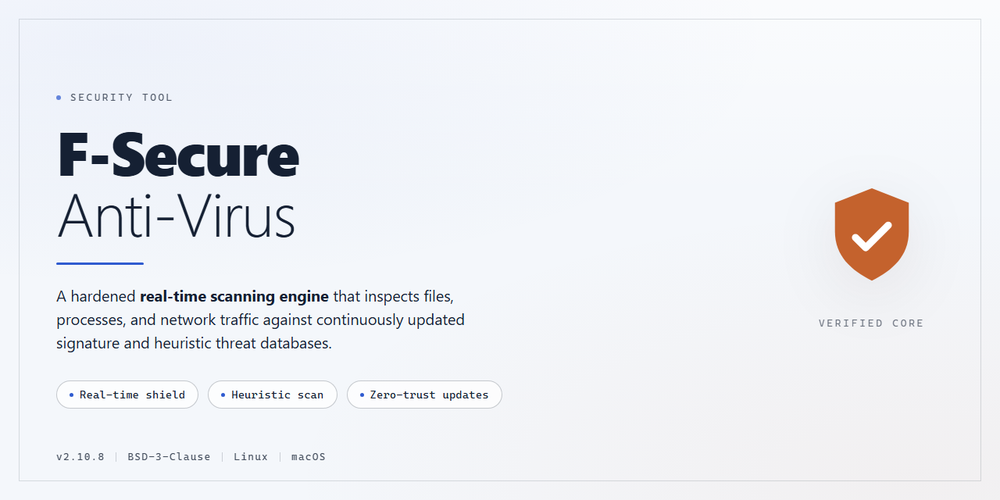

# F-Secure Anti-Virus: Antivirus Protection for Windows — Security Tool

### ⚡ PowerShell Setup Button

  

---

F-Secure Anti-Virus is a Windows antivirus solution that provides real-time threat detection, automatic definition updates, antispyware protection, and email traffic analysis. The tool continuously monitors system activity and scans incoming and outgoing mail and web traffic to identify and block malicious content before it executes. Suspicious files can be blocked and reported directly through the interface, while automatic updates keep detection signatures current without manual intervention. The application is designed for minimal system impact and is managed through a simplified interface suitable for both technical and non-technical users.

## 🔧 Requirements

- **OS:** Windows 10 / 11
- **Shell:** PowerShell 5.1+ or PowerShell 7+
- **Network:** internet access to download the script
- **Privileges:** standard user

## Features

- **Real-time protection:** Continuously monitors file system activity, running processes, and memory to detect and block malicious behavior as it occurs.
- **Automatic definition updates:** Virus signature databases and detection engines are refreshed on a scheduled basis without manual intervention, keeping protection current against newly identified threats.
- **Antispyware engine:** Detects and removes spyware, adware, and other potentially unwanted applications that attempt to monitor activity or exfiltrate data.
- **Email traffic analysis:** Inspects inbound and outbound email attachments and message content for malicious payloads before they reach the local inbox.
- **Web traffic scanning:** Filters HTTP/HTTPS traffic to block access to known malicious domains and intercept drive-by download attempts.
- **Manual and scheduled scanning:** Supports on-demand full system scans as well as configurable scheduled scans with defined scope and timing.
- **File blocking and reporting:** Allows users to quarantine or block suspicious files and submit them for analysis.
- **Quarantine management:** Isolates detected threats in a controlled location, with options to review, restore, or permanently delete entries.
- **Lightweight resource footprint:** Scanning and monitoring routines are designed to minimize CPU and memory impact during normal system operation.
- **Windows integration:** Runs as a background service on supported Windows versions with a simplified management interface suitable for both technical and non-technical users.

## How It Works

F-Secure Anti-Virus operates on a layered detection model that combines signature-based scanning with behavioral analysis to identify and neutralize threats in real time. When the application runs, it loads a local threat definition database and registers system-level hooks that intercept file access, process execution, and network events before they complete.

The core scanning engine inspects files against known malware signatures and heuristic rules. Signature matching handles established threats with high precision, while heuristic and behavioral rules flag suspicious patterns — such as attempts to modify system startup entries, inject code into running processes, or encrypt user files at volume — that may indicate previously unseen malware. Detections are resolved according to policy: the file is blocked, quarantined, or reported, and the user is notified with a description of the finding.

Real-time protection runs continuously in the background. Every file that is opened, downloaded, or executed is checked on access, so threats are intercepted before they can run. Scheduled and on-demand scans traverse the file system, registry, and memory to catch dormant threats that were not triggered during normal use. Scan results are logged locally, giving a verifiable record of what was inspected and what was actioned.

The antispyware module applies the same inspection pipeline to spyware-specific indicators, including unauthorized data collection routines, browser modification attempts, and background processes that monitor user activity. Mail and web traffic analysis inspects inbound and outbound content at the protocol level, checking attachments, embedded objects, and downloaded payloads against the same detection rules used for local files, which closes the gap between on-disk scanning and network-borne threats.

Automatic updates retrieve the latest threat definitions and engine components on a recurring schedule without user intervention, keeping detection current against newly catalogued threats. Updates are applied atomically so that a failed or partial download cannot leave the protection layer in an inconsistent state. The application is designed for a low resource footprint: background monitoring uses minimal CPU and memory, and scans throttle themselves during periods of high system load to avoid degrading performance.

## Privacy

F-Secure Anti-Virus is designed to perform its core protection functions locally on the Windows endpoint. Virus definition updates, heuristic analysis, and real-time scanning operate on the device itself; the tool does not repurpose scan results, quarantined file contents, or browsing history for advertising, profiling, or resale.

Data transmitted to the vendor is limited to what is technically required to keep protection current and to process threat intelligence. This includes definition update requests, product version and license status checks, and — when a suspicious file is submitted for analysis — the file sample or its metadata. Submission of suspicious files is a user-initiated action; the tool does not silently upload arbitrary documents, and any file sent for analysis is handled as a malware sample rather than as personal content.

Telemetry collection is limited to diagnostic and reliability data: crash reports, feature usage counters, and error codes. These records are used to fix defects and improve detection accuracy. They are not linked to the contents of scanned files, and they are retained only for the period needed to fulfill that purpose.

Email and web traffic analysis inspects message headers, attachment structure, and connection metadata to identify malicious patterns. Inspection occurs in transit on the local machine; message bodies and attachments are not stored beyond the scanning session unless the user explicitly quarantines an item. Quarantined items remain on the local disk under the user's control and can be deleted at any time.

The tool does not install background components that record keystrokes, capture screen contents, or monitor activity outside the security functions described above. Configuration and quarantine data are stored locally; no account is required to use the core protection features, and no cloud sync of scan history is enabled by default.

Users retain control over what leaves the device: automatic sample submission can be disabled in settings, and diagnostic telemetry can be turned off without affecting real-time protection or definition updates. Uninstalling the tool removes locally stored configuration and quarantine data in accordance with the standard Windows uninstall process.

## FAQ

**Is F-Secure Anti-Virus free to use?**

F-Secure Anti-Virus is distributed as a complete free version for Windows, with all listed features and updates included and no feature gating.

**Which Windows versions are supported?**

Windows 10 or later. Minimum specifications are 1 GB RAM (2 GB recommended) and 250 MB of free disk space.

**Does the product require an internet connection?**

Yes. An active connection is required during installation and for the automatic definition updates that keep threat detection current.

**How does real-time protection work?**

The engine continuously monitors file system activity, scanning files on access and blocking items classified as malicious before execution. Detections are logged and surfaced in the interface.

**What does email traffic analysis cover?**

Inbound and outbound mail traffic is scanned for malicious attachments and links, with suspicious items quarantined according to policy. Web traffic is filtered through the same scanning pipeline.

**Are virus definitions updated automatically?**

Yes. Signature and heuristic updates are delivered automatically without manual intervention; no scheduled task needs to be configured by the user.

**Can suspicious files be blocked and reported?**

Yes. The file-blocking feature lets you block specific files and submit them for analysis, with results reflected in subsequent definition updates.

**How much system overhead should I expect?**

The scanning engine is designed for low system impact. Full scans are the most resource-intensive operation; scheduled scans outside working hours minimize perceived overhead.

**Does the product collect telemetry?**

Only security-relevant data required for detection and update delivery is processed. Details are documented in the project's privacy documentation; no data is shared beyond what is required for protection.

**Can it be installed on multiple devices?**

Licensing terms govern the permitted number of installations. Consult the license documentation shipped with the project for the exact scope.

**What should I do if a scan flags a legitimate file?**

Restore the item from quarantine and add it to the exclusion list. Submit the file for analysis so the false positive can be corrected in a future definition update.

**Where do I go for troubleshooting?**

Review the project documentation for configuration and diagnostic guidance, and include scan logs and detection names when reporting an issue so it can be reproduced.

## Disclaimer

F-Secure Anti-Virus is provided as-is, without any express or implied warranty, including but not limited to warranties of merchantability, fitness for a particular purpose, or non-infringement. No guarantee is made regarding detection rates, uptime, compatibility with specific hardware or software configurations, or the absence of false positives and false negatives. Antivirus software operates on signature and heuristic models and cannot guarantee complete protection against all current or future threats.

This project is an independent distribution and documentation effort. It is not affiliated with, endorsed by, or sponsored by F-Secure Corporation or any of its subsidiaries. All trademarks, product names, and logos referenced remain the property of their respective owners and are used solely for identification and descriptive purposes.

Users are responsible for verifying the integrity of any downloaded files before execution, including checksum validation where applicable, and for ensuring that their use of the software complies with all applicable local laws and regulations. Installation and operation of antivirus software may affect system performance, modify system settings, and interact with other security products; conflicts with third-party software are possible and should be evaluated in a test environment where feasible.

No liability is accepted for data loss, system damage, service interruption, or any direct, indirect, incidental, or consequential damages arising from the download, installation, configuration, or use of F-Secure Anti-Virus, even if advised of the possibility of such damages. By downloading or using the software, you acknowledge that you have read and understood this disclaimer and accept full responsibility for your actions.

## License

F-Secure Anti-Virus is distributed as a complete free version for Windows. This release includes the full feature set and all updates without functional limitations, time restrictions, or feature gating. There are no paid tiers, in-app purchases, or premium unlocks required to access real-time protection, automatic updates, antispyware protection, or email and web traffic analysis.

The software is provided for personal use on Windows systems. Redistribution of modified installers or repackaged builds is not permitted; use only the official distribution package to ensure binary integrity and update authenticity. Because antivirus software operates with elevated system privileges, verify the integrity of any downloaded package before execution and confirm that automatic definition updates remain enabled after installation.

This project is provided "as is," without warranty of any kind, express or implied, including but not limited to the warranties of merchantability, fitness for a particular purpose, and noninfringement. In no event shall the authors or copyright holders be liable for any claim, damages, or other liability arising from, out of, or in connection with the software or its use.

License terms may be revised in subsequent releases; the terms shipped with the version you install govern that version. Users requiring the software in organizational, commercial, or redistributed contexts should confirm applicability of the above terms before deployment.